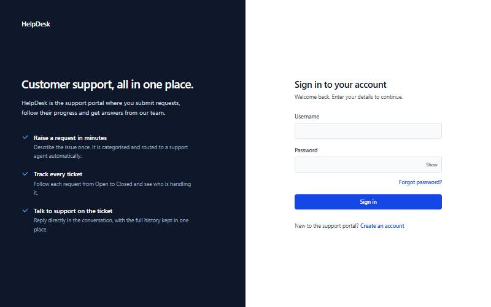
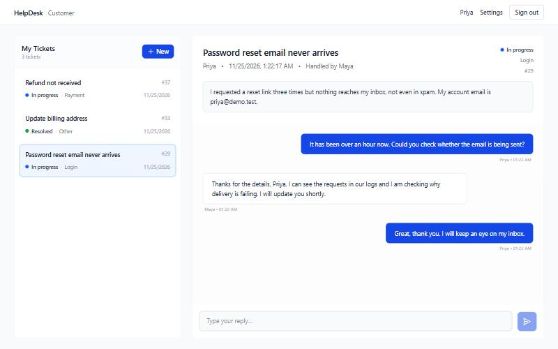
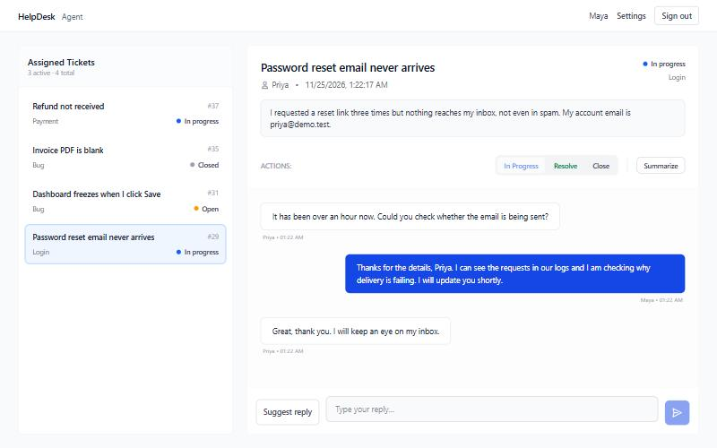
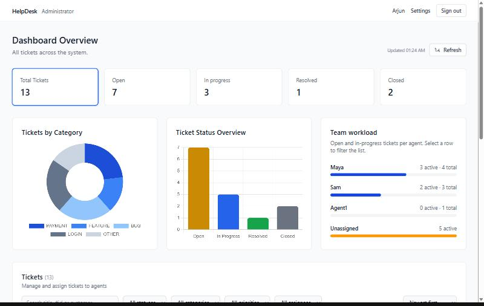
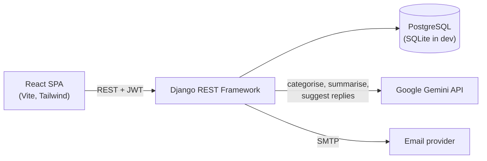
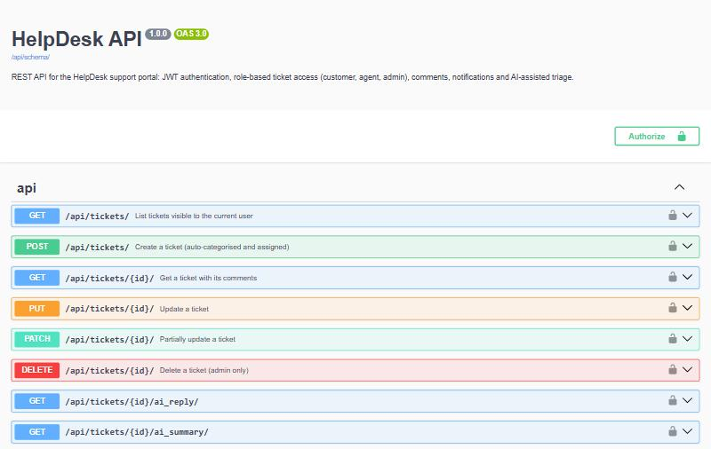

# HelpDesk: Support Ticketing System

[](https://github.com/Srikanthpv21/Ticketing-System/actions/workflows/ci.yml)


A full-stack support portal. Customers raise tickets and talk to support, agents work the tickets assigned to them, and admins see the whole system and balance the workload. Tickets are categorised automatically with Google Gemini, with a safe fallback when the AI is unavailable.

**Stack:** Django 5 · Django REST Framework · JWT (SimpleJWT) · PostgreSQL / SQLite · React 19 · Vite · Tailwind CSS 4 · Docker

| Login | Customer |
|---|---|
|  |  |

| Agent workspace | Admin dashboard |
|---|---|
|  |  |

## Features

**Tickets and conversation**
- Customers create tickets and reply in a threaded conversation; new tickets are auto-categorised (Login, Payment, Bug, Feature, Other) and assigned to the agent with the fewest active tickets.
- Status lifecycle: `OPEN → IN_PROGRESS → RESOLVED → CLOSED`.
- Agents get AI-generated ticket summaries and suggested replies (always editable before sending).
- Email notifications for new replies, status changes and assignments, with per-user preferences.

**Roles and permissions**

| | Customer | Agent | Admin |
|---|---|---|---|
| See tickets | their own | assigned to them | all |
| Create tickets | yes | n/a | n/a |
| Reply on a ticket | their own | assigned to them | any |
| Change status | no | yes | yes |
| Reassign | no | their own tickets | any ticket |
| Delete a ticket | no | no | yes |
| AI summary / reply | no | yes | yes |

Public sign-up only ever creates **customers**; agents and admins are created by an administrator.

**Admin dashboard:** status counts that double as filters, category / status charts, team workload per agent, search, filters (status, category, priority, assignee), sorting and pagination.

**Accounts and security**
- JWT access + refresh tokens with automatic refresh on the client.
- Password reset by email (one-time, expiring link; the endpoint never reveals whether an email exists; rate limited).
- Change password, sign out on all devices, close account (customers).
- Responsive from small phones to wide desktops.

## Architecture



```
backend/
  users/      custom User (role, notification prefs, token_version), auth, account endpoints
  tickets/    Ticket / Comment models, API, AI helpers, notifications, pagination
  backend/    settings and URL config
frontend/
  src/pages/        Login, Register, password reset, Customer / Agent / Admin dashboards, Settings
  src/components/   shared UI (badges, auth layout, navbar, animated counters)
  src/api/client.js axios instance with token refresh
```

### Design decisions worth knowing

- **Role-scoped querysets.** Visibility is enforced in `get_queryset`, not in the UI, so an agent or customer can never fetch another user's ticket by guessing an id. Filters and search narrow this scoped set; they can't widen it (covered by a test).
- **Instant session invalidation.** Tokens carry the user's `token_version`. Signing out everywhere, changing or resetting a password, or closing an account bumps the version, which kills every previously issued access *and* refresh token immediately instead of waiting for expiry.
- **Opt-in pagination.** `GET /api/tickets/` returns a plain list; adding `?page=` or `?page_size=` (max 100) returns `{count, next, previous, results}`. This keeps existing clients working while giving the API real pagination.
- **No N+1 queries.** The ticket list uses `select_related` and a `Prefetch` for comments, and a regression test asserts the query count does not grow with the number of tickets.
- **AI is optional and isolated.** Without a key, or on any API error, the helpers return safe fallbacks and log the error server-side (internals are never returned to the client). Ticket text is passed to the model as delimited data to reduce prompt injection.
- **Notifications never break a request.** Email failures are logged and swallowed; the API call that triggered them still succeeds.

## Run it locally

### With Docker

```bash
git clone https://github.com/Srikanthpv21/Ticketing-System.git
cd Ticketing-System
docker compose up --build
```

Frontend: http://localhost:5173 · API: http://localhost:8000 · API docs: http://localhost:8000/api/docs/

Set `GEMINI_API_KEY` in your shell first if you want AI features (optional). The compose file runs migrations and seeds demo data.

### Without Docker

**Backend** (Python 3.11+)

```bash
cd backend
python -m venv venv
source venv/bin/activate          # Windows: venv\Scripts\activate
pip install -r requirements.txt
cp .env.example .env              # Windows: copy .env.example .env
python manage.py migrate
python manage.py seed_ticket_data # demo users and sample tickets
python manage.py runserver
```

**Frontend** (Node 20+)

```bash
cd frontend
cp .env.example .env              # Windows: copy .env.example .env
npm ci
npm run dev
```

### Demo accounts (development only)

`seed_ticket_data` creates `customer1`, `agent1` and `admin1`, all with the password `password123`. These exist for local development; never seed them on a real deployment.

With `DEBUG=True` (the `.env.example` default) the app prints password-reset and notification emails in the backend terminal, so no mail server is needed locally.

## Configuration

Backend (`backend/.env`, see `.env.example`):

| Variable | Purpose |
|---|---|
| `DJANGO_SECRET_KEY` | Required when `DEBUG` is not `True` (the app refuses to start without it) |
| `DEBUG` | Defaults to `False`; set `True` for local development |
| `ALLOWED_HOSTS`, `CORS_ALLOWED_ORIGINS` | Comma-separated hosts / frontend origins |
| `DB_ENGINE` and `DB_*` | PostgreSQL settings; SQLite is used if unset |
| `GEMINI_API_KEY` | Enables AI features (optional) |
| `FRONTEND_URL`, `APP_NAME` | Used in email links and subjects |
| `EMAIL_HOST`, `EMAIL_PORT`, `EMAIL_HOST_USER`, `EMAIL_HOST_PASSWORD`, `DEFAULT_FROM_EMAIL` | Real email delivery (otherwise emails print to the console) |
| `JWT_ACCESS_TOKEN_LIFETIME` | Access token lifetime in minutes (default 60) |

Frontend (`frontend/.env`): `VITE_API_BASE_URL`, plus optional `VITE_APP_NAME` and `VITE_SUPPORT_EMAIL` for branding.

When `DEBUG` is off, secure cookies, HSTS and an HTTPS redirect are enabled. Set `SECURE_SSL_REDIRECT=False` if you run behind plain HTTP.

## API

Interactive docs (Swagger UI) are served at **`/api/docs/`**, with the OpenAPI schema at `/api/schema/`. Use the *Authorize* button with an access token from `/auth/login/`.

| Method | Path | Description |
|---|---|---|
| POST | `/auth/register/` | Create a customer account |
| POST | `/auth/login/` | Get access and refresh tokens |
| POST | `/auth/refresh/` | Exchange a refresh token for a new access token |
| GET, PATCH | `/auth/me/` | Current user; update profile and notification preferences |
| POST | `/auth/change-password/` | Change password (signs out other devices) |
| POST | `/auth/sign-out-everywhere/` | Invalidate every session |
| POST | `/auth/close-account/` | Deactivate a customer account |
| POST | `/auth/password-reset/` | Email a reset link |
| POST | `/auth/password-reset/confirm/` | Set a new password from a reset link |
| GET, POST | `/api/tickets/` | List (filters, search, optional pagination) / create |
| GET, PATCH, DELETE | `/api/tickets/{id}/` | Ticket detail with comments |
| POST | `/api/tickets/{id}/comments/` | Add a comment |
| PATCH | `/api/tickets/{id}/update_status/` | Change status (agent / admin) |
| GET | `/api/tickets/{id}/ai_summary/`, `/ai_reply/` | AI helpers (agent / admin) |
| GET | `/api/tickets/agents/` | List agents (agent / admin) |

`GET /api/tickets/` accepts `status`, `category`, `priority`, `assigned_to` (an id or `none`), `search`, `page` and `page_size`.



## Deploying

The backend runs on any host that can run Django (it ships with gunicorn); the frontend is a static Vite build. A typical setup is the API on Render with PostgreSQL and the frontend on Cloudflare Pages.

- **Backend build / pre-deploy command:** `pip install -r requirements.txt && python manage.py migrate && python manage.py bootstrap_accounts`
- **Backend start command:** `gunicorn backend.wsgi`
- **Frontend build:** root `frontend`, command `npm run build`, output `dist`, with `VITE_API_BASE_URL` pointing at the API.
- Set the variables from the table above, in particular `DJANGO_SECRET_KEY`, `ALLOWED_HOSTS`, `CORS_ALLOWED_ORIGINS` (your frontend URL), `FRONTEND_URL` and the `EMAIL_*` settings.

Hosts without a shell can create the first accounts with `bootstrap_accounts`. For each role you want, set `BOOTSTRAP_<ADMIN|AGENT|CUSTOMER>_USERNAME` and `_PASSWORD` (and optionally `_EMAIL`). It skips roles that are not configured, never changes users that already exist, rejects weak passwords and never prints passwords, so it is safe to run on every deploy.

## Testing and CI

```bash
cd backend
python manage.py test                       # 74 tests
coverage run manage.py test && coverage report   # about 91% line coverage
```

The tests cover models, the API and permission rules, auth flows (including token invalidation and password reset), notifications, pagination and filters, the query-count guarantee, and the AI helpers with a mocked model. They never call the real Gemini API.

GitHub Actions (`.github/workflows/ci.yml`) runs on every push and pull request:
- **Backend:** install, check for missing migrations, run tests with coverage, validate the OpenAPI schema.
- **Frontend:** `npm ci`, lint, production build.

## Known limitations

These are deliberate scope cuts, listed so you know what to expect:

- No email verification at sign-up.
- No automated frontend tests yet (backend is covered; the frontend is linted and built in CI).
- Emails are sent inside the request. For heavy traffic they belong on a background queue (for example Celery).
- Dashboards load the full ticket list. The API supports pagination, but the UI still paginates on the client.
- Tokens are kept in `localStorage`, which is simple but exposed if the site has an XSS bug; httpOnly cookies would be stronger.
- Updates are not pushed live; users see new messages on refresh or when they act.
- No file attachments, and internal notes exist in the data model but have no UI.
- The AI integration uses the `google-generativeai` package, which Google has deprecated in favour of `google-genai`.

## License

[MIT](LICENSE)
